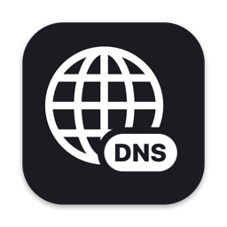
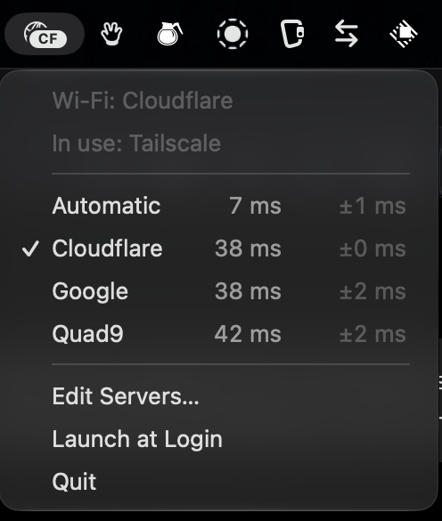

#  Deeanes

A tiny macOS menu bar app for switching system-wide DNS servers in one click, with live latency for each server.



- **One click, whole system.** Applies to every enabled network service (Wi-Fi, Ethernet, USB tethering). VPN services like Tailscale manage their own DNS and are left alone.
- **Live latency.** While the menu is open, every server gets a real DNS query each second, with jitter and packet loss over the last 30 s. Your router's row ("Automatic") is a quick read on Wi-Fi quality.
- **Encrypted DNS.** A lock marks servers that macOS automatically upgrades to DNS over HTTPS or TLS (see below).
- **Ad-block detection.** A shield marks servers that block ads.
- **Interception warning.** A red line appears if your network or ISP is secretly answering DNS for you.
- **Menu bar badge.** Shows which server is active (`CF`, `G`, …), including after changes made in System Settings.
- **Editable list.** Rename, reorder, add, or remove servers, and set your own badge, in Edit Servers.

## Resource use

Measured on an M4 MacBook Air (macOS 27), v0.0.2:

| | Menu closed | Menu open (checks every second) |
|---|---|---|
| CPU | 0% (0.01 s of CPU per minute) | ~1.2% of one core |
| Memory | 14 MB | 22 MB |
| Network | None | ~1.5 KB/s of DNS queries* |

\*Estimated from packet sizes for the default list, since macOS doesn't track traffic per app for short-lived UDP queries.

## Install

1. Download `Deeanes-<version>.dmg` from [Releases](../../releases), open it, and drag Deeanes to Applications. It is about 490 KB. A `.zip` is also there if you prefer.
2. Open Deeanes from Applications.
3. The app is not notarized, so macOS blocks the first launch. Allow it in **System Settings → Privacy & Security → Open Anyway**, or run:
   ```sh
   xattr -dr com.apple.quarantine /Applications/Deeanes.app
   ```

You need an admin account on the Mac. Deeanes changes DNS through macOS's `networksetup` and doesn't need a helper or your password. It requires an Apple Silicon Mac with macOS 13 or later.

## Build from source

You only need the Xcode Command Line Tools (`xcode-select --install`):

```sh
./build.sh                   # → build/Deeanes.app
./dist.sh                    # → build/Deeanes-<version>.dmg and .zip (DMG needs uv)
swift tools/make-icon.swift  # regenerates Resources/AppIcon.icns
```

## Notes

- If a VPN with its own DNS is on (for example Tailscale with "Use Tailscale DNS"), the menu shows "In use: …". In that case, the VPN may override the server you pick.
- **Encrypted DNS.** macOS 13 and later upgrade a plain DNS server to DNS over HTTPS (DoH) or DNS over TLS (DoT) by themselves, through [DDR](https://www.rfc-editor.org/rfc/rfc9462). This works when the server advertises an encrypted endpoint whose certificate includes the server's IP address. Deeanes runs the same check and shows a lock on servers that pass it. Cloudflare, Google, Quad9, AdGuard DNS and OpenDNS pass it. NextDNS, Mullvad and Control D's free resolver don't. Custom DoH URLs and DNS over QUIC (DoQ) aren't supported: macOS only uses those through a configuration profile or a network extension.

Built almost entirely with AI coding agents.

## License

[GPL-3.0](LICENSE)
